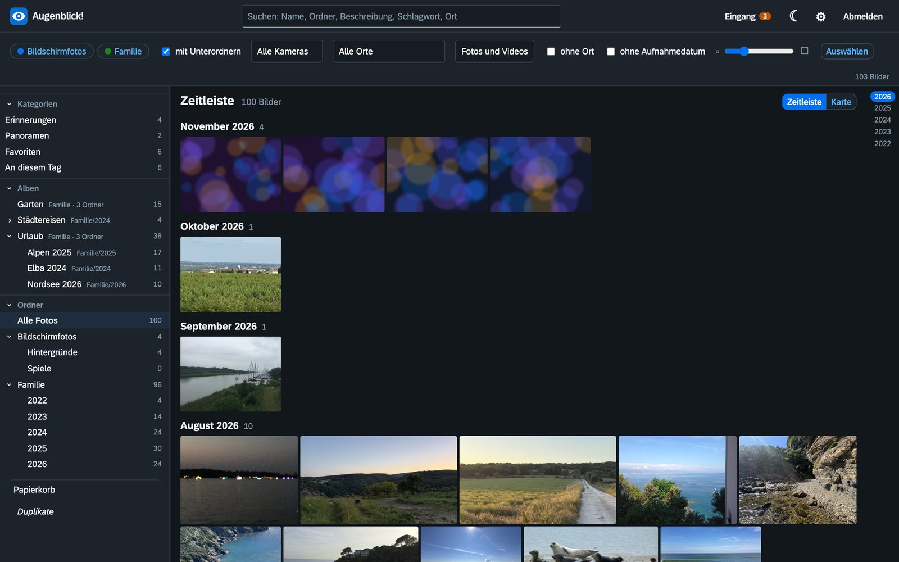
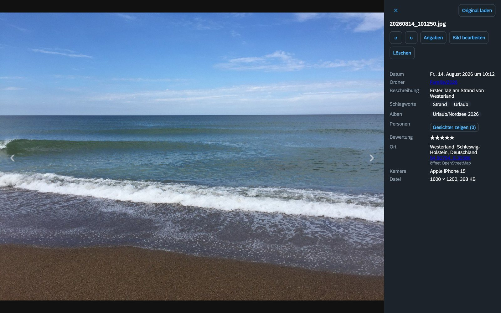
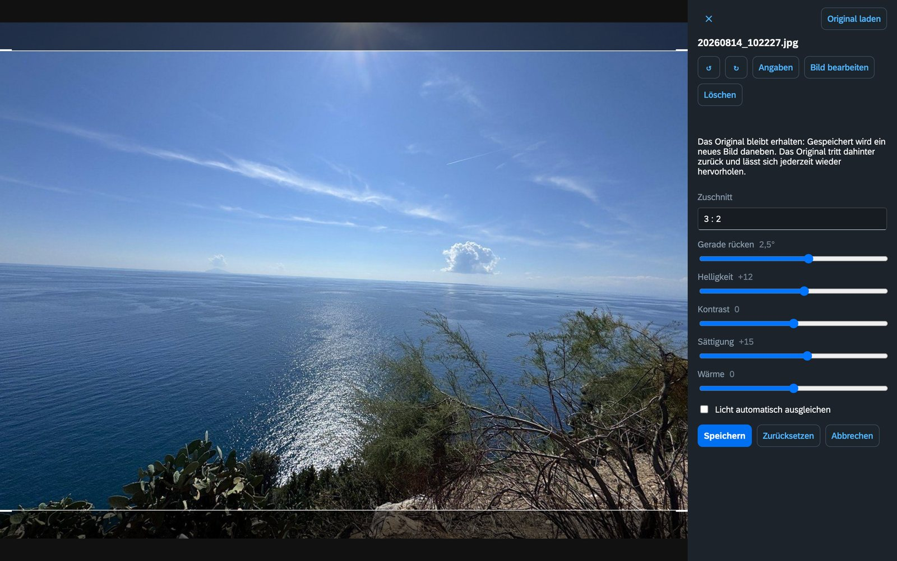
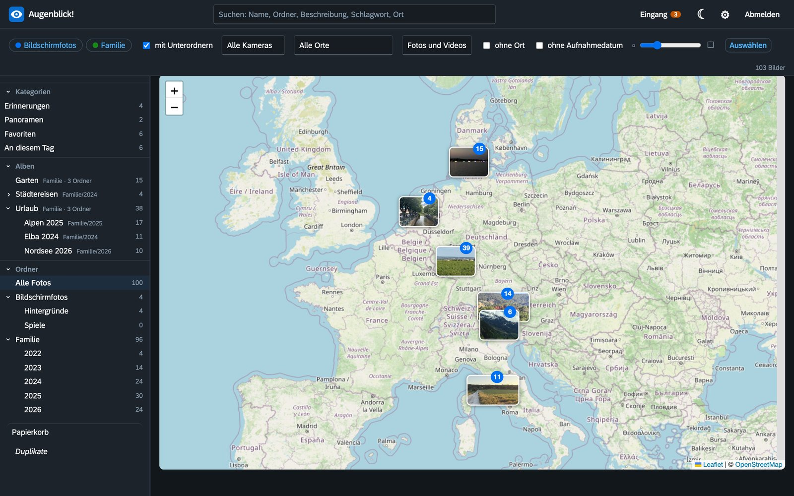
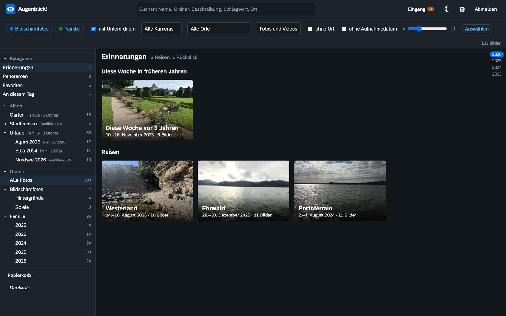

<p align="center"></p>

<h1 align="center">Augenblick!</h1>

<p align="center"><b>Die Fotoverwaltung, die deine Fotos in Ruhe lässt – deine Ordner bleiben, wie sie sind, und was du über ein Bild weißt, steht im Bild selbst.</b><br>
Selbst gehostet · Open Source (AGPL-3.0) · Deutsch, Englisch, Französisch, Italienisch</p>

<p align="center"><a href="https://worldgate.de/augenblick/"><b>Website</b></a> · <a href="https://worldgate.de/augenblick/handbuch/">Handbuch</a> · <i>English: <a href="README.md">README.md</a></i></p>



## Warum noch eine Fotoverwaltung?

Die meisten Fotoserver nehmen deine Bilder in eine eigene Ablage und merken sich in einer Datenbank, was du darüber weißt. Schaltest du den Server ab, bleiben Dateien mit kryptischen Namen, und Alben, Daten und Namen sind weg. **Augenblick!** dreht das um: **Die Ordner sind die Wahrheit.** Es zeigt die Ordner, die du schon hast, und lässt sie, wo sie sind. Datum, Ort, Beschreibung, Schlagworte, Alben und die Namen der Personen stehen in der Bilddatei, in den Feldern, die auch Lightroom, digiKam oder Apple Fotos lesen. Die Datenbank ist nur ein Index und lässt sich jederzeit aus den Fotos neu aufbauen.

## Funktionen

- **Zeitleiste, Ordnerbaum, Karte und Einzelansicht** – Bilder in ihrer eigenen Form, Filter nach Kamera, Ort, Bereich; Suche über Name, Ordner, Beschreibung, Schlagworte, Ort und Fotograf.
- **Datum, Ort, Beschreibung, Schlagworte, Fotograf, Bewertung ändern** – für ein Bild oder für Hunderte auf einmal (die Uhr der Kamera ging zwei Stunden falsch? alle verschieben). Den Ort wählst du auf der Karte.
- **Alles lässt sich zurücknehmen.** Jede Änderung wird geprüft, bevor sie das Foto ersetzt, das Journal kennt die alten Werte, Löschen heißt Papierkorb.
- **Verlustfreies Drehen** von JPEG (jpegtran) und HEIC; markierte Gesichter drehen mit.
- **Bilder bearbeiten:** zuschneiden, gerade rücken, Licht und Farben – als neues Bild neben dem Original, das dahinter unangetastet bleibt.
- **Alben, die im Foto stehen** (hierarchische Schlagworte), **Kategorien, die sich selbst füllen** (Videos, Live Photos, Panoramen, Favoriten, RAW, An diesem Tag) und **Erinnerungen**: Reisen und „Diese Woche in früheren Jahren“, aus Datum und Ort gefunden.
- **Startseite und Ansehen:** zuerst die Bilder, die zuletzt dazugekommen sind (egal wie alt), dazu Erinnerungen und angepinnte Alben. Jedes Album, jede Auswahl und jede Erinnerung lässt sich bildschirmfüllend ansehen – von Hand oder als Diashow.
- **Personen.** Gesichter werden auf dem eigenen Rechner gefunden und gruppiert (keine Cloud, keine Grafikkarte); Namen stehen als übliche XMP-Regionen im Bild.
- **Duplikate**, auch dasselbe Bild in anderer Größe; was nur die Kopie weiß, wird vorher übernommen.
- **Ordnen nach Regeln**, wenn du magst: ein Ordner je Jahr, Dateiname aus dem Datum – mit Vorschau, nie ohne deine Ansage.
- **Upload vom Telefon** über WebDAV (PhotoSync und andere) in einen Eingang, mit einem Schlüssel je Telefon, der nichts kann außer abliefern. Ein Schlüssel kann den Namen des Fotografen in die Bilder schreiben, und Bilder behalten das Datum, das das Telefon für sie kannte.
- **Eingang abarbeiten:** Die KI schlägt für Neues Beschreibung und Schlagworte vor (auf Knopfdruck oder von selbst), Gesichter werden schon dort erkannt. Du streichst, was nicht passt, und sortierst mit einem Klick ein – danach kommt das nächste Bild.
- **Filme und Live Photos**, HEIC, ProRAW (DNG, nur lesend).
- **Bereiche und Rechte je Person**, zweiter Faktor, Heimnetz-Regeln, Meldungen über ntfy, REST-API (`/api/docs`) mit benannten API-Schlüsseln (nur lesen oder lesen und schreiben).
- **Für KI-Assistenten (MCP):** Ein Assistent wie Claude kann über `/api/mcp` suchen, Bilder ansehen und – mit einem Schlüssel, der schreiben darf – Metadaten, Alben und Namen schreiben, verschieben, einsortieren und in den Papierkorb legen. Aus bei einer frischen Installation, eingeschaltet unter *Einstellungen → KI*.
- **KI, wenn du willst** (Claude, Ollama oder ein anderer OpenAI-kompatibler Dienst): schlägt Beschreibung und Schlagworte vor, benennt eine Erinnerung. Sie schreibt nie von selbst – mit einer Ausnahme, die du selbst startest: den Bestand beschreiben lassen, also jedes Bild ohne Schlagworte, damit die Suche Bilder nach ihrem Inhalt findet („Meer“, „Hochzeit“). Jede dieser Änderungen lässt sich zurücknehmen.
- **Vier Sprachen:** Deutsch, Englisch, Französisch, Italienisch – je Konto wählbar.

<table>
<tr><td></td><td></td></tr>
<tr><td></td><td></td></tr>
</table>

## Schnellstart mit Docker

```yaml
services:
  augenblick:
    image: ghcr.io/orohde/augenblick:latest
    container_name: augenblick
    restart: unless-stopped
    ports:
      - "8450:8000"
    volumes:
      - ./fotos:/fotos            # deine Foto-Ordner – jeder Ordner direkt darunter ist ein Bereich
      - ./data:/data              # Index, Vorschaubilder, Konten, Journal
    environment:
      - TZ=Europe/Berlin
      - AUGENBLICK_READONLY=false # ohne diese Zeile sieht Augenblick! nur zu und schreibt nie
```

```bash
docker compose up -d
```

Dann `http://localhost:8450` öffnen. Beim ersten Aufruf legst du dort den ersten Administrator an (nur aus dem Heimnetz). Alles Weitere – Benutzer, Bereiche, Gesichtersuche, Upload vom Telefon, KI, Sprache – stellst du im Programm ein.

Das Image gibt es für `linux/amd64` und `linux/arm64` (Raspberry Pi, Apple Silicon). Lege eine Sicherung deiner Fotos an, bevor du irgendein Programm hineinschreiben lässt – auch dieses.

| Variable | Standard | Bedeutung |
|---|---|---|
| `AUGENBLICK_READONLY` | `true` | `false` erlaubt Augenblick!, in die Foto-Ordner zu schreiben (die beschreibbar eingehängt sein müssen) |
| `PUID` / `PGID` / `UMASK` | `99` / `100` / `0002` | Benutzer, Gruppe und umask, unter denen das Programm läuft, wenn der Container als root startet (mit `--user` ohne Wirkung); die Foto-Ordner werden nie umgeschrieben |
| `TZ` | `UTC` | Zeitzone, z. B. `Europe/Berlin` |
| `AUGENBLICK_RESCAN_MINUTES` | `15` | wie oft die Ordner nach neuen oder geänderten Dateien durchgesehen werden |
| `AUGENBLICK_INTERNAL_NETWORKS` | private Netze | was als Heimnetz zählt (auch unter *Einstellungen → Sicherheit*) |
| `VERSIONSPRUEFUNG` | an | `0` schaltet die tägliche Frage nach neuen Versionen dauerhaft ab (siehe unten) |

## Neue Versionen

Einmal am Tag fragt Augenblick! bei `version.worldgate.de`, ob es eine neue Version gibt. Gibt es eine, sehen Admins oben einen Knopf mit Anleitung zum Aktualisieren. Übertragen werden dabei nur der Name der App, die installierte Version und die Installationsart (z. B. Docker), keine Kennung, keine Fotos und keine Namen. Gespeichert werden dort nur Tagessummen, keine IP-Adressen. Daraus sehen wir, wie viele Installationen ungefähr laufen. Abschalten lässt sich das unter *Einstellungen → System* oder dauerhaft mit `VERSIONSPRUEFUNG=0`.

## Die Demo ausprobieren

`tools/demo/make_demo.py` zeichnet einen kleinen erfundenen Bestand (ganz ohne echte Fotos):

```bash
python tools/demo/make_demo.py /tmp/augenblick-demo
AUGENBLICK_PHOTOS=/tmp/augenblick-demo/fotos AUGENBLICK_DATA=/tmp/augenblick-demo/data AUGENBLICK_READONLY=false python -m augenblick
```

## Im Einzelnen

- **Erst prüfen, dann tauschen.** Jede Änderung entsteht als neue Datei neben dem Foto. Erst wenn feststeht, dass die
  Bilddaten Bit für Bit dieselben sind und die neuen Angaben so drinstehen wie gewünscht, ersetzt sie das Foto.
  Scheitert eine Prüfung, bleibt das Foto, wie es war.
- **Drehen ohne Verlust.** JPEGs werden mit `jpegtran` gedreht, ohne neu zu kodieren – geprüft, indem das Ergebnis
  zurückgedreht und mit dem Original verglichen wird. Danach steht die Ausrichtung auf „aufrecht“, das eingebettete
  Vorschaubild und die Maßangaben stimmen, und markierte Gesichter drehen mit. Passt die Bildgröße nicht ins Raster
  des JPEGs (dann ginge es nur mit Verlust), bleibt das Bild unangetastet und nur die Ausrichtungs-Markierung wird
  gesetzt; die Einzelansicht sagt das.
- **Journal.** Zu jeder Änderung stehen die genauen alten Werte im Journal (`journal.db`). Zurücknehmen stellt sie
  wieder her – solange das Bild seither nicht noch einmal geändert wurde.
- **Ort auf der Karte.** Klick oder Ortssuche setzt die Koordinaten. Kartenbilder und Suche kommen direkt von
  OpenStreetMap – dein Browser fragt dort an, sobald du die Karte öffnest; sonst geht nichts nach außen.
- **Ortsnamen.** Aus den Koordinaten wird der nächste Ort mit Bundesland und Land – auf diesem Rechner, aus der
  Ortsliste von GeoNames, die das Image mitbringt; dafür geht nichts nach außen. Die Namen stehen nur im Index
  (kein Bild wird dafür geschrieben), erscheinen in der Einzelansicht, in der Suche und als Filter.
- **Löschen mit Papierkorb.** Gelöschte Fotos wandern in den versteckten Ordner `.augenblick-papierkorb` ihres
  Bereichs (ein Umbenennen auf derselben Platte, keine Kopie) und lassen sich zurückholen. Nach einer einstellbaren
  Frist (Standard 30 Tage, 0 = nie) verschwinden sie endgültig.
- **KI auf Wunsch.** Claude (Anthropic), ein eigener Ollama-Server oder ein anderer OpenAI-kompatibler Dienst sieht
  sich ein Bild an und schlägt Beschreibung, Schlagworte und – bei undatierten Bildern – ein Datum vor. Der
  Vorschlag landet im Bearbeiten-Formular; geschrieben wird erst, wenn du es sagst. Ausgeschaltet, bis ein
  Administrator sie einrichtet; einzelne Bereiche lassen sich ausnehmen, ein Monatslimit begrenzt die Kosten.
- **Bereiche.** Ein Administrator legt in den Einstellungen neue Bereiche an (ein Ordner direkt unter den Fotos);
  sie gehören zunächst niemandem, Rechte gibt es je Benutzer. Je Bereich lässt sich abschalten, dass Bilder einen Ort
  oder ein Aufnahmedatum brauchen – etwa für Bildschirmfotos. Ausgewählte Bilder lassen sich in einen anderen
  Bereich verschieben, etwa aus einem Eingang, in den das Telefon hochlädt; sie landen dort, wo die Regel des
  Zielbereichs sie haben will.
- **Upload vom Telefon.** Apps wie PhotoSync laden neue Fotos über WebDAV hoch (`/dav/`). Diese Tür führt nur in
  einen Bereich, den du in den Einstellungen wählst: nachsehen, Ordner anlegen, Dateien ablegen – lesen, ändern oder
  löschen kann die App nichts, überschrieben wird nie. Der Upload-Schlüssel ist ein eigener und öffnet sonst nichts.
- **Konten und Sicherheit.** Bereiche je Person, zweiter Faktor (Authenticator-App), angemeldete Geräte,
  Heimnetz-Regeln, Benachrichtigung per ntfy, API-Schlüssel für Skripte: beliebig viele, je mit Namen und Recht
  („Nur lesen“ sieht alle Bereiche und ändert nichts, „Lesen und schreiben“ darf, was ein Administrator darf);
  gespeichert wird nur ein Fingerabdruck, der Schlüssel selbst wird einmal beim Anlegen gezeigt.
- **Zugang für KI-Assistenten (MCP).** Der Endpunkt `/api/mcp` spricht das Model Context Protocol (Streamable
  HTTP) und nimmt denselben Schlüssel wie die REST-API als `Authorization: Bearer <Schlüssel>`. Er ist bei einer
  frischen Installation aus; ein Administrator schaltet ihn unter *Einstellungen → KI* ein. Die Werkzeuge: Bereiche,
  Ordner, Alben, Personen, Orte, Kameras und Erinnerungen auflisten, Fotos suchen und filtern, Details lesen, eine
  kleine Vorschau ansehen, Gesichter, Eingang, Papierkorb und Änderungen ansehen – und mit Schreibrecht Metadaten
  ändern, Alben befüllen, drehen, Gesichter benennen, verschieben, aus dem Eingang einsortieren, in den Papierkorb
  legen, zurückholen und Änderungen zurücknehmen. Rechte, Journal und Papierkorb gelten wie in der Oberfläche; ein
  Schlüssel mit Leserecht bekommt keine schreibenden Werkzeuge angeboten. Endgültig löschen und die Einstellungen
  der Installation gibt es über MCP nicht.
- **Ordnen nach Regeln, wenn du willst.** Je Ordner lässt sich festlegen, wohin Bilder gehören und wie sie heißen,
  etwa `{Jahr}` und `{JJJJMMTT}_{HHMMSS}`. „Passt nicht zum Schema“ zeigt die Abweichler, „Einsortieren“ verschiebt
  nach Vorschau. Ohne Regel wird nie etwas verschoben oder umbenannt; nichts wird überschrieben, leere Ordner
  verschwinden, jedes Verschieben lässt sich zurücknehmen.
- **Alben stehen im Bild.** Ein Album ist ein Schlagwort mit Hierarchie (`lr:hierarchicalSubject`,
  `Album|Urlaub|USA 2010`) in der Datei selbst – es übersteht Verschieben, Umbenennen und einen neuen Index.
  Ein Ordner lässt sich mit einem Klick als Album in seine Bilder schreiben.
- **Personen stehen im Bild.** Wer auf einem Foto ist, steht als benannte Region in der Datei
  (`mwg-rs:RegionInfo`, Typ Face) – so, wie es auch Lightroom, digiKam oder Picasa lesen. Regionen aus anderen
  Programmen werden angezeigt und bleiben beim Schreiben, wie sie sind. Die Zeitleiste lässt sich nach einer Person
  filtern.
- **Gesichter finden, auf diesem Rechner.** Auf Wunsch sucht Augenblick! im Hintergrund Gesichter, stellt ähnliche
  zusammen und schlägt für bekannte Gesichter den Namen vor. Kein Bild geht dafür nach außen, eine Grafikkarte
  braucht es nicht. Die Suche liest nur; geschrieben wird ein Name erst, wenn du ihn bestätigst. Was die Suche
  ausrechnet (wo Gesichter sind, wie sie aussehen), liegt in einer eigenen Datei `faces.db`, die sich jederzeit
  wegwerfen und neu berechnen lässt. Ausgeschaltet, bis ein Administrator sie unter Einstellungen → Personen
  einschaltet – für jeden Bereich einzeln. Modelle: YuNet (MIT) und SFace (Apache 2.0) aus dem OpenCV Zoo.
- **Personen pflegen.** Ein Gesicht, das die Suche nicht gefunden hat, lässt sich in der Einzelansicht von Hand
  einrahmen und benennen. Fremde, Statuen und Plakate lassen sich verwerfen: Sie werden nicht mehr vorgeschlagen
  (das steht in `faces-ignored.db`, nicht im Bild, und lässt sich zurückholen). Eine Person lässt sich in allen
  Bildern umbenennen; mit einem Namen, den es schon gibt, werden zwei Personen zu einer.
- **Personen aus Immich übernehmen.** Einmalig, unter Einstellungen → Personen: Augenblick! fragt Immich (nur
  lesend), wen es mit Namen kennt, sucht dieselben Bilder hier – über den Pfad, sonst über die unveränderte Datei,
  sonst über Name und Aufnahmezeit – und zeigt eine Vorschau. Erst nach Bestätigung werden die Namen als Regionen
  in die Bilder geschrieben. Adresse und Schlüssel werden nicht gespeichert.
- **Noch nicht:** RAW-Dateien und ältere Videoformate (etwa AVI, MPG) ändern, andere Formate als JPEG und HEIC drehen, Gesichter in Videos.

## Grundsätze

- **Deine Ordner sind die Wahrheit.** Kein Import, keine eigene Ablage. Augenblick! liest die Ordner, die es schon gibt.
  Jeder Ordner direkt unter dem Foto-Verzeichnis ist ein *Bereich*; Konten bekommen Rechte je Bereich.
- **Metadaten stehen in der Datei.** Datum, Ort, Beschreibung, Schlagworte, Bewertung und Personen werden ins Bild
  geschrieben (EXIF/IPTC/XMP), bei Videos (MOV, MP4) in die Datei des Films. Keine Sidecar-Dateien; RAW-Dateien
  bleiben, wie die Kamera sie geschrieben hat.
- **Die Datenbank ist nur ein Index.** Eine kleine SQLite-Datei, die sich jederzeit aus den Fotos neu aufbauen lässt.
- **Verlustfrei, wo es geht.** Drehen ohne Neukodierung; jede Änderung steht im Journal und lässt sich zurücknehmen.
- **Ein Container.** Python, FastAPI, keine weiteren Dienste nötig.

## Entwicklung

```
python3 -m venv .venv
.venv/bin/pip install -e ".[dev]"
.venv/bin/python -m pytest -q
AUGENBLICK_PHOTOS=./fotos AUGENBLICK_DATA=./data .venv/bin/python -m augenblick
```

Die Gesichtssuche braucht zwei Modelldateien (zusammen rund 39 MB). Das Docker-Image bringt sie mit; für die
Entwicklung holt sie `.venv/bin/python -m augenblick.faces fetch models` einmalig und prüft ihre Prüfsummen.
Gesucht werden sie unter `AUGENBLICK_MODELS`, sonst im Ordner `models` des Datenverzeichnisses. Wie viel eines
Prozessorkerns die Suche belegen darf, sagt `AUGENBLICK_FACES_LOAD` (Vorgabe 0.5).

Die Ortsnamen kommen aus der Ortsliste von [GeoNames](https://www.geonames.org/) (CC BY 4.0). Das Docker-Image holt
sie beim Bauen und macht daraus eine kleine Datei (`places.db`, rund 20 MB); die Sprache der Namen bestimmt das
Build-Argument `GEO_LANG` (Vorgabe `de`). Für die Entwicklung: `.venv/bin/python -m augenblick.geo fetch models/geo de`
(lädt einmalig rund 220 MB) und `AUGENBLICK_GEO=models/geo`. Ohne die Datei bleiben die Ortsnamen einfach leer.

## Lizenz

AGPL-3.0-or-later, siehe [LICENSE](LICENSE).
