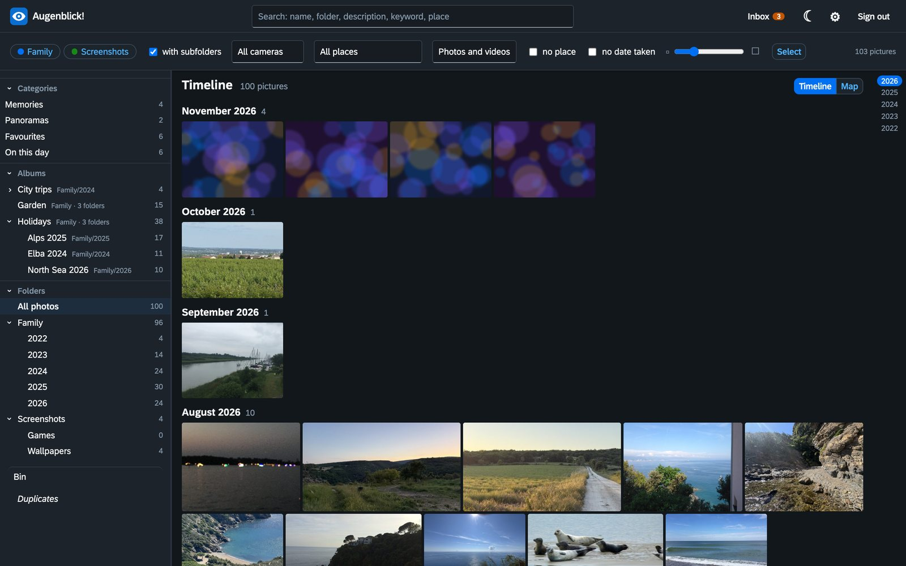
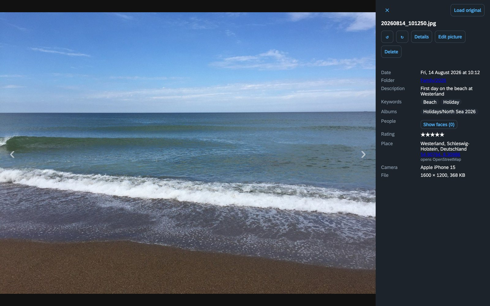
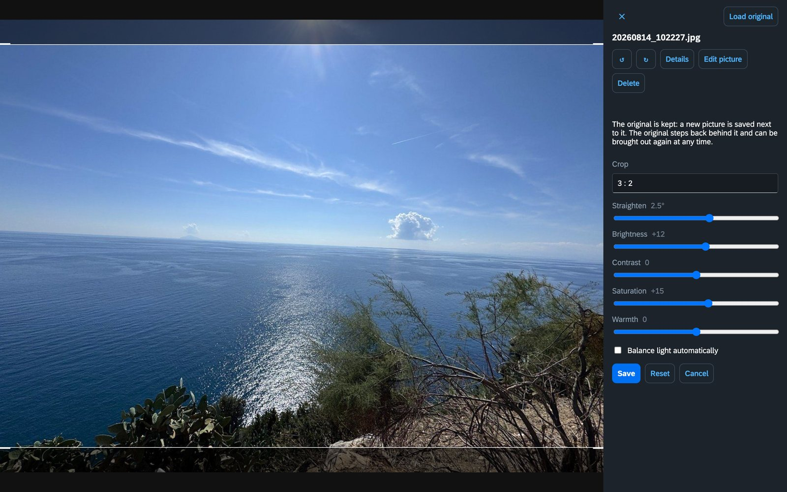
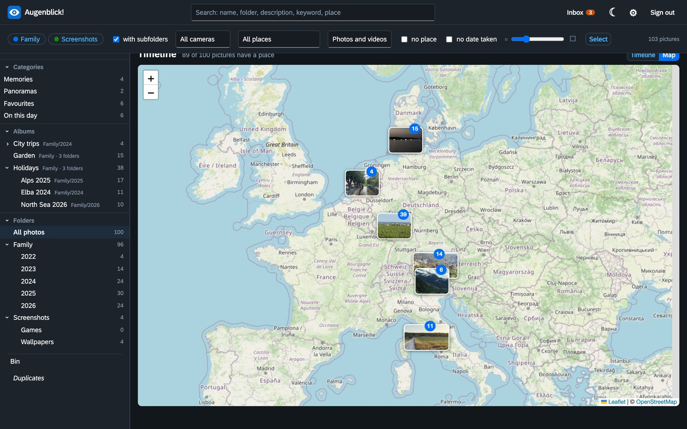
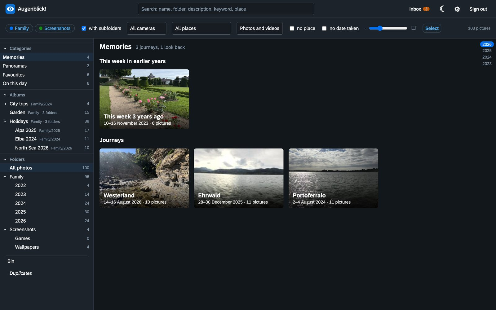

<p align="center"></p>

<h1 align="center">Augenblick!</h1>

<p align="center"><b>A photo library that leaves your photos alone – your folders stay as they are, and what you know about a picture is written into the picture itself.</b><br>
Self-hosted · open source (AGPL-3.0) · German, English, French, Italian</p>

<p align="center"><a href="https://worldgate.de/en/augenblick-en/"><b>Website</b></a> · <a href="https://worldgate.de/en/augenblick-en/manual/">Manual</a> · <i>Deutsch: <a href="README.de.md">README.de.md</a></i></p>



> **The name.** *Augenblick* is German for “moment” – literally the “blink of an eye” (*Auge* eye, *Blick* glance). Said with an exclamation mark it also means “just a moment!”.

## Why another photo library?

Most photo servers take your pictures into a store of their own and keep what you know about them in a database. Switch the server off and you are left with files named by hash, and your albums, dates and names are gone. **Augenblick!** turns it around: **the folders are the truth.** It shows the folders you already have and leaves them where they are. Date, place, description, keywords, albums and the names of people are written into the image file, in the fields Lightroom, digiKam or Apple Photos read as well. The database is only an index that can be rebuilt from the photos at any time.

## Features

- **Timeline, folder tree, map and single view** – pictures in their own shape, filters by camera, place, area; search over name, folder, description, keywords, place and photographer.
- **Change date, place, description, keywords, photographer, rating** – for one picture or hundreds at once (the camera clock was off by two hours? shift them all). The place is picked on a map.
- **Everything can be undone.** Every change is checked before it replaces the photo, the journal keeps the old values, deleting means the bin.
- **Lossless rotation** of JPEG (jpegtran) and HEIC; marked faces turn with the picture.
- **Edit pictures:** crop, straighten, light and colours – as a new picture beside the original, which stays untouched behind it.
- **Albums that live in the photo** (hierarchical keywords), **categories that fill themselves** (videos, Live Photos, panoramas, favourites, RAW, on this day) and **memories**: journeys and “this week in earlier years”, found from date and place.
- **Start page and viewing:** first the pictures that came in last (however old they are), with memories and pinned albums. Every album, selection and memory can be viewed full screen – by hand or as a slide show.
- **People.** Faces are found and grouped on your own machine (no cloud, no graphics card); names are stored as standard XMP regions.
- **Duplicates**, also the same picture in another size; what only the copy knows is merged first.
- **Sorting by rules**, if you want: a folder per year, file names from the date – with a preview, never without your say.
- **Upload from the phone** over WebDAV (PhotoSync and others) into an inbox, with a key per phone that can do nothing but deliver. A key can sign what it delivers with the photographer's name, and pictures keep the date the phone had for them.
- **Working through the inbox:** the AI proposes a description and keywords for what arrives (on request or by itself), and faces are found there already. Strike out what does not fit and sort the picture in with one click – then the next one comes up.
- **Films and Live Photos**, HEIC, ProRAW (DNG, read only).
- **Areas and rights per person**, second factor, home-network rules, notifications via ntfy, REST API (`/api/docs`) with named API keys (read only or read and write).
- **For AI assistants (MCP):** an assistant such as Claude can search via `/api/mcp`, look at pictures and – with a key that may write – write metadata, albums and names, move, sort in and put in the trash. Off in a fresh installation, switched on under *Settings → Connections*.
- **AI if you want it** (Claude, Ollama or any OpenAI-compatible server): proposes descriptions and keywords, names a memory. It never writes by itself – with one exception you start yourself: letting it describe every picture that has no keywords yet, so that the search finds pictures by what they show (“sea”, “wedding”). Every such change can be undone.
- **Four languages:** German, English, French, Italian – chosen per account.

<table>
<tr><td></td><td></td></tr>
<tr><td></td><td></td></tr>
</table>

## Quick start with Docker

```yaml
services:
  augenblick:
    image: ghcr.io/orohde/augenblick:latest
    container_name: augenblick
    restart: unless-stopped
    ports:
      - "8450:8000"
    volumes:
      - ./fotos:/fotos            # your photo folders – each folder directly below is an area
      - ./data:/data              # index, previews, accounts, journal
    environment:
      - TZ=Europe/Berlin
      - AUGENBLICK_READONLY=false # without this line Augenblick! only looks and never writes
```

```bash
docker compose up -d
```

Open `http://localhost:8450`. On the first visit you create the first administrator there (only from the home network). Everything else – users, areas, face search, upload from the phone, AI, language – is set in the app.

The image is built for `linux/amd64` and `linux/arm64` (Raspberry Pi, Apple silicon). Make a backup of your photos before you let any programme write to them – this one included.

| Variable | Default | Meaning |
|---|---|---|
| `AUGENBLICK_READONLY` | `true` | `false` lets Augenblick! write into the photo folders (which must be mounted writable) |
| `PUID` / `PGID` / `UMASK` | `99` / `100` / `0002` | user, group and umask the app runs as when the container starts as root (ignored with `--user`); the photo folders are never chowned |
| `TZ` | `UTC` | time zone, e.g. `Europe/Berlin` |
| `AUGENBLICK_RESCAN_MINUTES` | `15` | how often the folders are looked through for new or changed files |
| `AUGENBLICK_INTERNAL_NETWORKS` | private ranges | what counts as the home network (also under *Settings → Security*) |
| `VERSIONSPRUEFUNG` | on | `0` switches the daily check for new versions off for good (see below) |
| `AUGENBLICK_TRUSTED_PROXIES` | private ranges | Which addresses may report the client address via `X-Forwarded-For`, comma-separated (IP or network, e.g. `10.10.20.50`). Best set to your reverse proxy's address |
| `AUGENBLICK_MAX_UPLOAD_MB` | `100` | Largest request in MB (not for WebDAV); larger ones get 413 |
| `AUGENBLICK_DAV_MAX_GB` | `16` | Largest single file uploaded over WebDAV in GB; an upload is also refused if less than 1 GB would stay free |

## New versions

Once a day Augenblick! asks `version.worldgate.de` whether a new version exists. If so, admins see a button at the top with update instructions. Only the app name, the installed version and the kind of installation (e.g. Docker) are sent: no identifier, no photos, no names. The service keeps daily totals only, no IP addresses. That tells us roughly how many installations are running. Switch it off under *Settings → About*, or for good with `VERSIONSPRUEFUNG=0`.

## Try the demo

`tools/demo/make_demo.py` draws a small made-up library (no real photo needed):

```bash
python tools/demo/make_demo.py /tmp/augenblick-demo en
AUGENBLICK_PHOTOS=/tmp/augenblick-demo/fotos AUGENBLICK_DATA=/tmp/augenblick-demo/data AUGENBLICK_READONLY=false python -m augenblick
```

## In detail

- **Check first, then swap.** Every change is made as a new file next to the photo. Only when it is certain that the
  picture data is bit for bit the same and the new values are stored as asked does it take the photo's place. If a
  check fails, the photo stays as it was.
- **Turning without loss.** JPEGs are turned with `jpegtran`, without re-encoding – proven by turning the result back
  and comparing it with the original. Afterwards the orientation says "upright", and the embedded thumbnail and the
  size tags are right, and marked faces turn with the picture. If the picture's size does not fit the JPEG's block
  grid (turning would then lose data), the picture is left alone and only the orientation tag is set; the single
  view says so.
- **Journal.** The exact old values of every change are kept in the journal (`journal.db`). Taking a change back
  restores them – as long as the photo has not been changed again since.
- **Place on the map.** A click or the place search sets the coordinates. Map tiles and search come straight from
  OpenStreetMap – your browser asks there once you open the map; nothing else leaves your network.
- **Place names.** The coordinates become the nearest town with its state and country – on this machine, from the
  GeoNames town list the image ships; nothing leaves your network for it. The names live in the index only (no photo
  is written for them) and show in the single view, the search and as a filter.
- **Deleting with a trash.** Deleted photos move into the hidden folder `.augenblick-papierkorb` of their area (a
  rename on the same disk, no copy) and can be brought back. After a time you set (30 days by default, 0 = never)
  they are removed for good.
- **AI if you want it.** Claude (Anthropic), your own Ollama server or another OpenAI-compatible service looks at a
  picture and proposes a description, keywords and – for undated pictures – a date. The proposal lands in the edit
  form; nothing is written until you say so. Off until an administrator sets it up; areas can be excluded and a
  monthly limit caps the cost.
- **Areas.** An administrator creates new areas in the settings (a folder directly below the photos); they belong to
  nobody at first, rights are given per user. Per area you can switch off that pictures need a place or a date from
  the camera – for screenshots, say. Chosen photos can be moved to another area, from an inbox the phone uploads
  to, say; they land where the rule of the target area wants them.
- **Upload from the phone.** Apps like PhotoSync upload new photos over WebDAV (`/dav/`). That door leads into one
  area you choose in the settings: look, make folders, put files – the app can read, change or delete nothing, and
  nothing is ever overwritten. The upload key is a key of its own and opens nothing else.
- **Accounts and security.** Areas per person, second factor (authenticator app), signed-in devices, home-network
  rules, notifications via ntfy, API keys for scripts: as many as you like, each with a name and a right (“Read
  only” sees every area and changes nothing, “Read and write” may do what an administrator may); only a fingerprint
  is stored, the key itself is shown once, when it is created.
- **Access for AI assistants (MCP).** The endpoint `/api/mcp` speaks the Model Context Protocol (streamable HTTP)
  and takes the same key as the REST API as `Authorization: Bearer <key>`. It is off in a fresh installation; an
  administrator switches it on under *Settings → Connections*. The tools: list areas, folders, albums, people, places, cameras
  and memories, search and filter photos, read details, look at a small preview, see faces, the inbox, the trash and
  the changes – and with the right to write change metadata, fill albums, rotate, name faces, move, sort in from the
  inbox, put in the trash, restore and take changes back. Rights, journal and trash apply as in the interface; a
  read-only key is offered no writing tool. Deleting for good and the settings of the installation are not
  available over MCP.
- **Sorting by rules, if you want it.** Per folder you can say where photos belong and what they are called, e.g.
  `{Jahr}` and `{JJJJMMTT}_{HHMMSS}` (the building blocks are German: year, date, time). A filter shows what does
  not fit, sorting moves after a preview. Without a rule nothing is ever moved or renamed; nothing is overwritten,
  empty folders go, and every move can be taken back.
- **Albums live in the photo.** An album is a hierarchical keyword (`lr:hierarchicalSubject`,
  `Album|Urlaub|USA 2010`) in the file itself – it survives moving, renaming and a new index. A folder can be
  written into its photos as an album with one click.
- **People live in the photo.** Who is on a photo is stored as a named region in the file (`mwg-rs:RegionInfo`,
  type Face) – the way Lightroom, digiKam or Picasa read it. Regions from other programmes are shown and stay as
  they are when names are written. The timeline can be filtered by person.
- **Finding faces, on this machine.** If you want, Augenblick! looks for faces in the background, groups the ones
  that look alike and proposes the name for faces it knows. No picture leaves the machine for this and no graphics
  card is needed. The search only reads; a name is written only once you confirm it. What the search works out
  (where the faces are, what they look like) is kept in a file of its own, `faces.db`, which can be thrown away
  and worked out again at any time. Off until an administrator switches it on in the settings – area by area.
  Models: YuNet (MIT) and SFace (Apache 2.0) from the OpenCV Zoo.
- **Looking after people.** A face the search did not find can be boxed by hand in the single view and named.
  Strangers, statues and posters can be waved away: they are no longer proposed (kept in `faces-ignored.db`, not
  in the photo, and can be brought back). A person can be renamed in all photos; with a name that exists already,
  two people become one.
- **Taking people over from Immich.** Once, in the settings: Augenblick! asks Immich (reading only) whom it knows
  by name, finds the same pictures here – by path, else by the unchanged file, else by name and the moment taken –
  and shows a preview. Only after you confirm are the names written into the photos as regions. Address and key
  are not stored.
- **Films and Live Photos.** A film shows when and where it was taken, how long it runs, and one picture out
  of it in the overview (exiftool, ffmpeg). The short film an iPhone takes with a Live Photo is part of that
  photo while the two lie in one folder: it is not a tile of its own, plays in the single view, and is moved,
  deleted and brought back together with its photo.
- **Albums that fill themselves.** Films, Live Photos, panoramas, favourites (four stars and more), raw files and
  "this day" in other years stand in the side bar on their own – nothing is written for them.
- **Raw files from the phone (DNG).** Shown through the finished picture they carry, never written to.
- **The overview shows pictures in their own shape,** in rows of equal height.
- **Memories.** Journeys (stretches of days away from where home was that year) and looks back at this week
  in earlier years are found in the photos themselves – from date and place, nothing is stored. Each opens
  with a few pictures that stand for it, or all of its days. If switched on, the AI can be asked to give one
  a title, a sentence and its cover; that alone is kept, in `memories.json`.
- **Working on the picture itself.** Cutting, setting straight, light and colours, with a preview. The result is a
  new JPEG beside the original, which is never changed: it is renamed to `…_original`, stands behind the new
  picture and goes wherever that goes. What was done is written in the new picture, so it can be done again
  from the original or taken back.
- **Not yet:** changing raw files and older video formats (such as AVI, MPG), turning formats other than JPEG and HEIC, faces in videos.

## Principles

- **Your folders are the truth.** No import, no private storage. Augenblick! reads the folders you already have.
  Each folder directly below the photo root is an *area*; accounts get rights per area.
- **Metadata lives in the file.** Date, place, description, keywords, rating and people are written into the image
  (EXIF/IPTC/XMP), for videos (MOV, MP4) into the film's own file. No sidecar files; raw files stay as the camera
  wrote them.
- **The database is only an index.** A small SQLite file that can be rebuilt from the photos at any time.
- **Non-destructive where possible.** Rotation is lossless; every change is journaled and can be undone.
- **One container.** Python, FastAPI, no external services required.

## Development

```
python3 -m venv .venv
.venv/bin/pip install -e ".[dev]"
.venv/bin/python -m pytest -q
AUGENBLICK_PHOTOS=./fotos AUGENBLICK_DATA=./data .venv/bin/python -m augenblick
```

The face search needs two model files (about 39 MB together). The Docker image ships them; for development
`.venv/bin/python -m augenblick.faces fetch models` fetches them once and checks their hashes. They are looked for
in `AUGENBLICK_MODELS`, otherwise in the folder `models` of the data directory. `AUGENBLICK_FACES_LOAD` says how
much of one processor core the search may take (0.5 by default).

Place names come from the town list of [GeoNames](https://www.geonames.org/) (CC BY 4.0). The Docker image fetches it
when it is built and boils it down to one small file (`places.db`, about 20 MB); the build argument `GEO_LANG`
(default `de`) sets the language of the names. For development: `.venv/bin/python -m augenblick.geo fetch models/geo de`
(a one-time download of about 220 MB) and `AUGENBLICK_GEO=models/geo`. Without the file the place names stay empty.

## License

AGPL-3.0-or-later, see [LICENSE](LICENSE).
